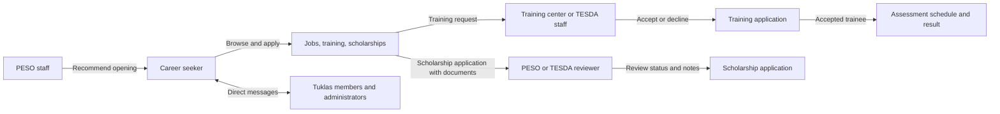
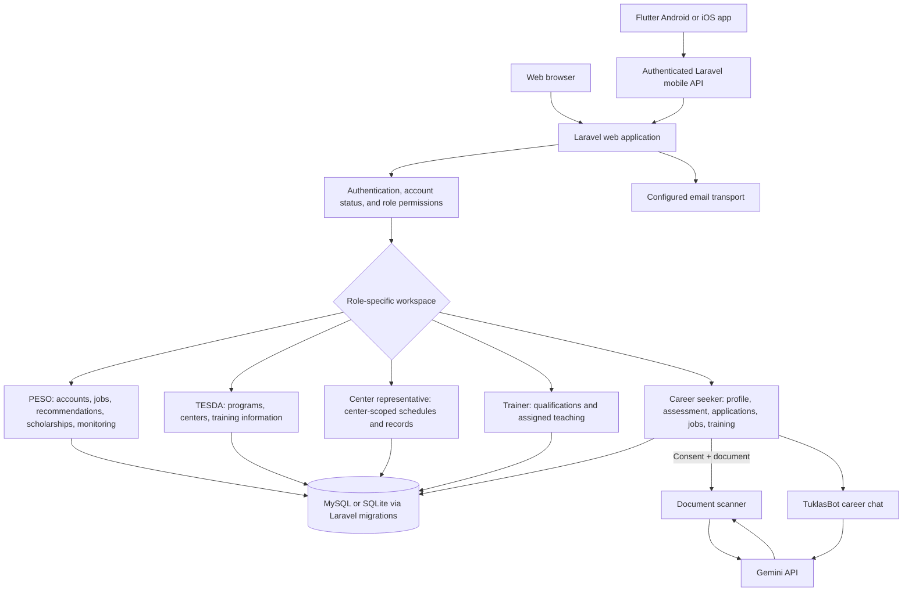
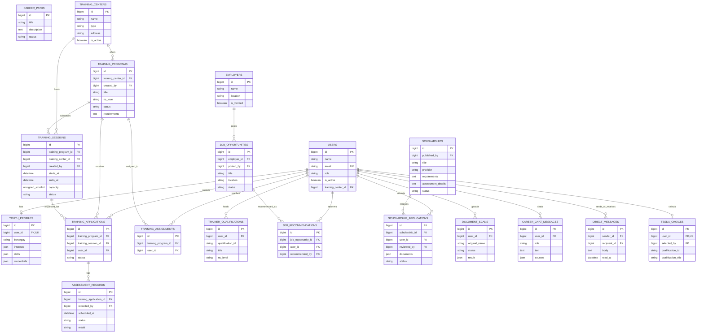

# Tuklas

Tuklas is a career-guidance and technical-vocational training platform for Pangasinan, piloting in Bugallon. It provides a Laravel web application and Flutter mobile app backed by the same Laravel API and database.

## What the system does

- Career seekers create a profile, complete a skills assessment, explore jobs, TESDA qualifications, training dates, and scholarships, and track training and scholarship applications.
- PESO administrators manage accounts and job opportunities, send job recommendations, publish scholarships, and monitor platform activity.
- TESDA administrators manage qualifications, training programs, participating centers, and scholarship information.
- Training-center representatives manage their assigned center's schedules, applications, trainers, and assessment records within their permissions.
- Trainers maintain their qualifications and assigned teaching list, and view relevant training activity.
- Members can message one another. TuklasBot offers AI career guidance; the document scanner can read a resume or certificate with the user's consent.
- Flutter clients use the same Laravel APIs and server-side records as the website. They do not have a separate system database. Production uses MySQL; local development can use MySQL or SQLite.

The PESO role is stored as `admin` and uses the same role value in web middleware, mobile API responses, and the Flutter app. A forward migration converts existing `super_admin` user rows without changing their records. Published seeded jobs, scholarships, training programs, centers, and upcoming sessions are available through the same role-authorized web and mobile catalogs. Requests, assessment results, and applications remain limited to the participant, authorized staff, and assigned training center.

AI output is guidance, not a guarantee of employment, admission, funding, or a training place. PESO job recommendations are selected by authorized staff; the system does not claim automatic qualification scoring.

## Roles and the normal user flow

### PESO Admin

1. Sign in and use the overview to review platform activity.
2. Manage career-seeker and authorized staff accounts, including role and center assignments.
3. Create, update, publish, or close job opportunities and recommend a published opening to an active career seeker.
4. Publish verified scholarship information and review scholarship applications.
5. Monitor training activity, messages, and user progress.

Employer information is stored with job opportunities. There is no separate Employers destination in the PESO navigation.

### TESDA training administrator

1. Maintain participating centers and training programs.
2. Publish accurate program details and qualification requirements.
3. Assign trainers and maintain training information.
4. Manage scholarships and review training activity according to permissions.

### Training-center representative

1. An administrator assigns the account to one training center.
2. Manage that center's schedules and available places.
3. Review training requests and keep trainer assignments current.
4. Record authorized assessment schedules and results. Center scoping limits the account to its assigned center.

### Trainer

1. Maintain trainer qualifications and review assigned courses.
2. View relevant sessions and communicate with Tuklas members.
3. TESDA administrators or center representatives handle center and schedule administration.

### Career seeker

1. Register, verify the email address, and complete the profile.
2. Record skills and interests, then optionally complete the skills assessment.
3. Browse career guidance, jobs, training qualifications, centers, open dates, and scholarships.
4. Review scholarship requirements and assessment information; submit an application and requested documents when ready.
5. Request a place in an open training session and track the request and assessment record.
6. Message administrators, trainers, or other active Tuklas members.

### Request and review flow



## Application architecture



`routes/web.php` serves browser pages. `routes/api.php` serves mobile JSON endpoints. Controllers and models hold the shared application behavior; authorization and role middleware restrict what each account can see and change.

## Database schema

Laravel migrations in `database/migrations/` are the source of truth for database structure. `php artisan migrate` creates the schema for MySQL or SQLite. The diagram shows the primary application tables and foreign-key relationships; Laravel also creates infrastructure tables for sessions, cache, queues, tokens, password resets, and migration tracking.



Other migrations create `password_reset_tokens`, `sessions`, `cache`, `cache_locks`, `jobs`, `job_batches`, `failed_jobs`, `personal_access_tokens`, `passkeys`, `social_accounts`, and polymorphic `notifications`. Catalog and training activity records include `is_demo` flags where applicable.

## Where the main features live

| Feature | Main implementation |
|---|---|
| Role definitions and dashboard routing | `app/Enums/Role.php`, `app/Http/Controllers/DashboardController.php`, `app/View/Composers/NavComposer.php` |
| Browser routes and mobile API routes | `routes/web.php`, `routes/api.php` |
| Account management | `app/Http/Controllers/Admin/UserController.php`, Laravel Fortify actions in `app/Actions/Fortify/` |
| Career-seeker profile and skills assessment | `app/Http/Controllers/YouthProfileController.php`, `app/Http/Controllers/SkillsAssessmentController.php`, `app/Models/YouthProfile.php` |
| TESDA catalog and training programs | `app/Http/Controllers/TesdaCatalogController.php`, `app/Http/Controllers/Trainer/TrainingProgramController.php`, `app/Models/TrainingProgram.php` |
| Training centers, dates, requests, and results | `app/Http/Controllers/TrainingCenterController.php`, `app/Http/Controllers/TrainingSessionController.php`, `app/Http/Controllers/Trainer/TrainingApplicationController.php`, `app/Http/Controllers/AssessmentRecordController.php` |
| Jobs and PESO recommendations | `app/Http/Controllers/JobOpportunityController.php`, `app/Http/Controllers/Admin/CareerRecommendationController.php` |
| Scholarships and applications | `app/Http/Controllers/ScholarshipController.php`, `app/Http/Controllers/ScholarshipApplicationController.php` |
| Document scanner and AI career chat | `app/Http/Controllers/DocumentScanController.php`, `app/Services/GeminiDocumentScanner.php`, `app/Http/Controllers/CareerChatController.php`, `app/Services/GeminiCareerAssistant.php` |
| Direct messages and notifications | `app/Http/Controllers/DirectMessageController.php`, `app/Http/Controllers/NotificationsController.php` |
| Flutter app | `tuklas_mobile/lib/`, with shared network code in `tuklas_mobile/lib/api.dart` |
| Database schema | `database/migrations/` |
| Seeders | `database/seeders/` |

## Requirements

- PHP 8.5.12 or newer and Composer 2
- PHP extensions: `ctype`, `curl`, `dom`, `fileinfo`, `filter`, `hash`, `mbstring`, `openssl`, `pcre`, `pdo`, `session`, `tokenizer`, and `xml`; plus `pdo_mysql` for MySQL or `pdo_sqlite` for SQLite
- Node.js 20.19+ or 22.12+ and npm
- Git
- Flutter and Android Studio for Android development; macOS and Xcode are required to build iOS

## Local setup on Windows with MySQL

Open PowerShell in the repository directory. Start MySQL in XAMPP, Laragon, or your local MySQL service. The example below assumes XAMPP's MySQL executable is at `C:\xampp\mysql\bin`.

Create a database and a local app user (replace the sample password before running):

```powershell
& "C:\xampp\mysql\bin\mysql.exe" -u root -p -e "CREATE DATABASE IF NOT EXISTS tuklas CHARACTER SET utf8mb4 COLLATE utf8mb4_unicode_ci; CREATE USER IF NOT EXISTS 'tuklas_local'@'127.0.0.1' IDENTIFIED BY 'replace-with-a-local-password'; GRANT ALL PRIVILEGES ON tuklas.* TO 'tuklas_local'@'127.0.0.1'; FLUSH PRIVILEGES;"
```

If XAMPP's `root` account has no password, remove `-p` from the command. Copy `.env.example` only if `.env` does not already exist, then set the local database and admin values:

```powershell
if (-not (Test-Path .env)) { Copy-Item .env.example .env }
```

```dotenv
APP_NAME=Tuklas
APP_URL=http://127.0.0.1:8000
DB_CONNECTION=mysql
DB_HOST=127.0.0.1
DB_PORT=3306
DB_DATABASE=tuklas
DB_USERNAME=tuklas_local
DB_PASSWORD=replace-with-a-local-password
TUKLAS_ADMIN_EMAIL=admin@tuklas.com
TUKLAS_ADMIN_NAME="PESO Bugallon Admin"
TUKLAS_ADMIN_PASSWORD="replace-with-a-strong-local-password"
TUKLAS_DEMO_PASSWORD="replace-with-a-local-demo-password"
```

Install dependencies, generate the app key, migrate the schema, and create the configured Admin account. The sample email and password above are for local setup only; set a real mailbox and strong secret in the production environment:

```powershell
composer install
npm ci
php artisan key:generate
php artisan migrate --seed
php artisan storage:link
npm run build
```

To create or update only the configured Admin account without reseeding catalog data, run:

```powershell
php artisan db:seed --class=AdminAccountSeeder --force
```

`TUKLAS_ADMIN_EMAIL` is the canonical Admin login email. Set it to the existing administrator's intended mailbox before running the seeder; if the old local demo Admin exists, the seeder converts it to that email and keeps its password unless `TUKLAS_ADMIN_PASSWORD` is set.

For local role testing, set `TUKLAS_DEMO_PASSWORD` and run `php artisan db:seed --class=DemoAccountsSeeder`. This creates Career Seeker, Trainer, and Admin demo logins; it is intentionally blocked in production.

For the fictional records used to test catalog and training workflows, run the separate seeder:

```powershell
php artisan db:seed --class=FictionalDemoCatalogSeeder
```

It creates 50 fictional training programs, job listings, scholarship scenarios, training dates, training requests, and assessment records across 5 fictional centers. These are test records, not real openings or official outcomes; their descriptions disclose that they are fictional. Do not seed them into a public production database unless you intend to show demo records there.

Start the local site:

```powershell
php artisan serve --host=127.0.0.1 --port=8000
```

Visit [http://127.0.0.1:8000](http://127.0.0.1:8000). The initial PESO administrator signs in with the email and password set in `.env`.

### MySQL inspection commands

```powershell
& "C:\xampp\mysql\bin\mysql.exe" -u root -p -D tuklas -e "SHOW TABLES;"
& "C:\xampp\mysql\bin\mysql.exe" -u root -p -D tuklas -e "SHOW CREATE TABLE training_programs;"
php artisan migrate:status
```

To create a no-data schema dump from the local database:

```powershell
& "C:\xampp\mysql\bin\mysqldump.exe" -u root -p --no-data --result-file=database-schema.sql tuklas
```

## Other local databases

SQLite is the default in `.env.example`. To use it, create the file before running migrations:

```powershell
New-Item -ItemType File -Path database\database.sqlite -Force
```

Set `DB_CONNECTION=sqlite` in `.env`. For macOS/Linux, follow the same Composer and Artisan steps, use `cp .env.example .env`, and create the SQLite file with `touch database/database.sqlite` if using SQLite. For MySQL, create the database and set the `DB_*` values as above.

## Flutter development

Install the Flutter SDK separately and check Android/iOS prerequisites with `flutter doctor`. From the repository root:

```powershell
Set-Location tuklas_mobile
flutter pub get
flutter devices
flutter run
```

The Laravel server and database must be running. The app's debug default targets the Android emulator at `http://10.0.2.2:8000/api/mobile`. For an iOS simulator:

```powershell
flutter run --dart-define=API_BASE=http://127.0.0.1:8000/api/mobile
```

For a physical phone, run Laravel on the local network and substitute the computer's LAN IP:

```powershell
# In the repository root
php artisan serve --host=0.0.0.0

# In tuklas_mobile, use your computer's LAN address
flutter run --dart-define=API_BASE=http://192.168.1.20:8000/api/mobile
```

The phone and computer must be on a reachable network, and the computer firewall must allow the Laravel port. Use HTTPS for release builds.

## Mobile releases

- Android APK releases are built and published by `.github/workflows/mobile-release.yml` after a push that changes `tuklas_mobile/` or that workflow, or by manually starting the workflow in GitHub Actions. It needs the Android signing and EC2 deployment secrets plus the `PUBLIC_APP_URL` repository variable. The workflow checks that the HTTPS API responds with a valid certificate before building and publishing the APK and update manifest under `public/app-updates/`.
- The website's mobile download page is served at `/app`; its Android download information comes from the published update manifest.
- iOS builds use `.github/workflows/ios-release.yml` and must be started manually. Signed TestFlight/App Store distribution needs Apple signing credentials and App Store Connect configuration. An IPA build alone does not publish the app to the App Store.
- The app's installed-version update prompt can download the published Android APK. iOS app updates must go through Apple's distribution process.

## Email and AI configuration

Configure secrets only in the untracked local `.env` or the deployment environment. Never commit credentials.

| Variable | Purpose |
|---|---|
| `GOOGLE_AI_API_KEY` | Enables Gemini document scans and career chat; the key stays on the Laravel server. |
| `GEMINI_MODEL` | Selects the configured Gemini model. |
| `MAIL_MAILER` | `phpmailer` for the PHPMailer SMTP transport, `smtp` for Laravel SMTP, or `log` for local inspection. |
| `MAIL_HOST`, `MAIL_PORT`, `MAIL_USERNAME`, `MAIL_PASSWORD`, `MAIL_SCHEME` | SMTP connection settings. |
| `MAIL_TIMEOUT` | SMTP connection timeout in seconds. |
| `MAIL_FROM_ADDRESS`, `MAIL_FROM_NAME` | Sender address and display name. |

For local email troubleshooting, `MAIL_MAILER=log` writes messages to `storage/logs/laravel.log`. Do not put AI-provider or SMTP credentials in the Flutter app.

## Daily development and verification

Run Laravel and Vite in separate terminals:

```powershell
php artisan serve
npm run dev
```

Build production assets with `npm run build`. Run the Laravel suite with `php artisan test`. From `tuklas_mobile/`, run `flutter analyze` and `flutter test`.

## Troubleshooting

| Problem | Check |
|---|---|
| `could not find driver` with MySQL | Enable `pdo_mysql` in the PHP CLI used by Artisan, then check `php --ini` and `php -m`. |
| MySQL `Access denied` | Check that MySQL is running and `.env` has the matching database, username, host, and password. Then run `php artisan config:clear`. |
| `Table doesn't exist` | Run `php artisan migrate --seed` against the intended local database. |
| `Vite manifest not found` or styles are missing | Run `npm ci` and `npm run build`, or keep `npm run dev` running. |
| `419 Page Expired` | Run `php artisan optimize:clear` and reload. |
| Email does not arrive | Check the configured mailer, SMTP host/port/TLS, sender, username, and app password; use `MAIL_MAILER=log` to inspect local messages. |
| Scanner or career chat reports AI unavailable | Confirm `GOOGLE_AI_API_KEY` is configured on Laravel and inspect `storage/logs/laravel.log`. |
| Flutter app cannot connect | Confirm the API URL is reachable from that device. Android emulator uses `10.0.2.2`; a physical phone needs a reachable LAN or HTTPS server URL. |
| `View [partials.tech-logos] not found` | Run `node scripts/make-tech-logos.mjs`. |
| Uploaded profile photos are missing | Run `php artisan storage:link`. |

## Project structure

```text
app/Enums/Role.php                    Role definitions and dashboard destinations
app/Http/Controllers/                 Web and API request handlers
app/Http/Middleware/EnsureRole.php    Role access control
app/Models/                           Eloquent models and relationships
app/Services/                         Gemini scanner and career assistant
app/Support/                          Shared profile and workflow helpers
app/View/Composers/NavComposer.php    Role-specific navigation
database/migrations/                  Versioned database schema
database/seeders/                     Admin, source catalog, and demo seeders
resources/views/                      Laravel Blade pages and shared layouts
resources/css/                        Website styles and themes
resources/js/                          Website interaction scripts
routes/web.php                        Browser routes
routes/api.php                        Mobile API routes
tuklas_mobile/lib/                    Flutter mobile application
.github/workflows/                    Android and iOS release automation
```

## Data and privacy notes

- Fictional seeded listings and activity records are for workflow testing; they are not real job openings, training slots, scholarship awards, or official assessment outcomes.
- Users' profile and application records are scoped by role and ownership. Administrative views do not grant career seekers access to other users' messages, scans, requests, or results.
- AI career and document analysis is advisory. Users must consent before sending a document to the scanner.
- Review the privacy notice and terms before inviting public users. Have the privacy notice reviewed for applicable data-protection obligations.

Capstone project of Tour de Force, Universidad de Dagupan.
