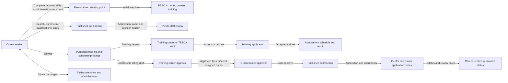
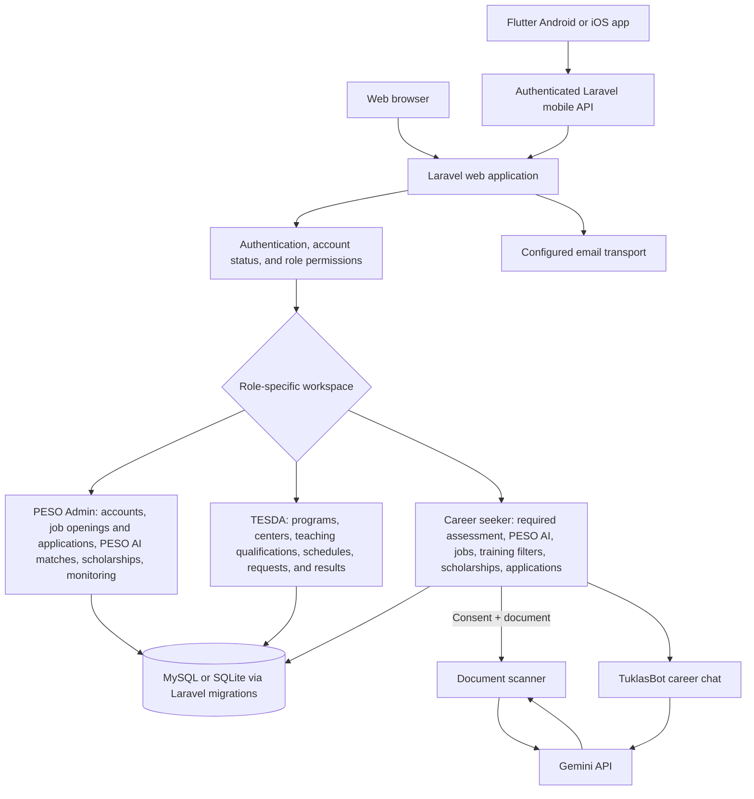
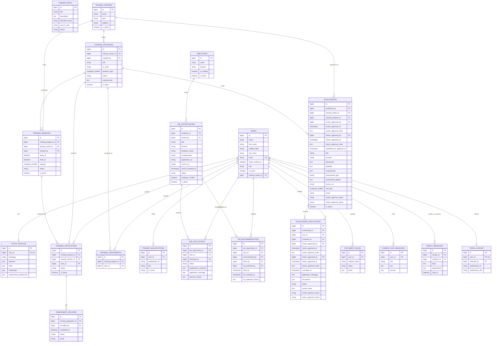

# Tuklas

Tuklas is a career-guidance and technical-vocational training platform for Pangasinan, piloting in Bugallon. It provides a Laravel web application and Flutter mobile app backed by the same Laravel API and database.

## What the system does

- Career seekers create a profile and complete a skills-and-interests assessment before the workspace opens. They can then explore PESO AI guidance, jobs, training, and scholarships, and track their applications.
- PESO administrators manage accounts and job opportunities, review hiring applications, send job recommendations, publish scholarships, and monitor platform activity.
- TESDA accounts manage qualifications, training programs, participating centers, staff assignments, schedules, requests, assessment records, and scholarship information.
- TESDA accounts assigned to a training center are limited to that center; unassigned TESDA accounts can manage the full training workspace.
- Members can message one another. TuklasBot offers AI career guidance; the document scanner can read resumes, certificates, and other supported documents with the user's consent. Web and mobile scanning support PDF, DOCX, and images, with camera capture where available.
- Career Seeker registration collects last name, first name, optional middle initial, municipality, barangay, contact number, and date of birth. Career Seeker accounts are limited to ages 18–30. Password forms show strength guidance and allow the password to be revealed.
- Flutter clients use the same Laravel APIs and server-side records as the website. They do not have a separate system database. Production uses MySQL; local development can use MySQL or SQLite.

The PESO role is stored as `admin` and uses the same role value in web middleware, mobile API responses, and the Flutter app. A forward migration converts existing `super_admin` user rows without changing their records. Published seeded jobs, scholarships, training programs, centers, and upcoming sessions are available through the same role-authorized web and mobile catalogs. Requests, assessment results, and applications remain limited to the participant, authorized staff, and assigned training center.

Career seekers must save at least one interest in the skills assessment before they can use the workspace. The assessment is a guided self-reflection, not an exam or certification. Saving it immediately produces initial matches for work, career paths, and training from published records, so a resume or NC certificate is not required to get started.

**PESO AI** is separate from PESO staff decisions. It shows advisory matches based on the career seeker's saved interests and skills, or career suggestions derived from a consented document scan. PESO staff manage job openings, send recommendations, review applications, and record hiring decisions. AI output is not a guarantee of employment, admission, funding, qualification, or an available training place.

TuklasBot supports casual career-guidance conversation and can recommend relevant links when available. Its advice and any external links should be checked before users act on them.

## Roles and the normal user flow

### PESO Admin

1. Sign in and use the overview to review platform activity.
2. Manage career-seeker and authorized staff accounts, including role and center assignments.
3. Use **Jobs > Openings** to create, update, publish, or close job opportunities. The **PESO AI** tab shows career seekers' scan-derived matches; **Applications** lists job applications for staff review.
4. Review job applications, move them under review, and record whether the applicant was hired or not selected. A reason is required for a not-selected decision and is sent to the career seeker.
5. Publish verified scholarship information and review scholarship applications.
6. Monitor training activity, messages, and user progress.

Employer information is stored with job opportunities. There is no separate Employers destination in the PESO navigation.

### TESDA

1. Browse the national qualification catalog and maintain teaching qualifications.
2. Manage local programs and publish verified details. Center-assigned accounts can save drafts for their center; unassigned accounts can publish across centers.
3. Assign TESDA staff to programs, maintain training dates, review requests, and record assessment results.
4. Review scholarship listings in two stages: the center first, then a different TESDA trainer assigned to one of its programs. Both must approve before the listing is published; a rejection returns it to draft.
5. Review scholarship applications in center and trainer stages, and communicate with Career Seekers and staff.
6. If an account is assigned to a center, its lists and write actions stay within that center.

### Career seeker

1. Register, verify the email address, and complete the profile.
2. Complete the required skills-and-interests assessment. Saving at least one interest opens the workspace and shows first job, career, and training suggestions. A resume or NC certificate is optional.
3. Use **Work > PESO AI** for advisory matches and **Find jobs** to search openings. Apply to a published job by providing a qualification summary and, optionally, a message; follow the application's status in the workspace.
4. Use **Training > Courses** to filter published programs by PTC, PSAT, or private training center. Review the center, course, duration, and any currently published future session before applying.
5. Review scholarship requirements and assessment information; submit an application and requested documents when ready. Available places are first come, first served; the career seeker can track center and trainer review statuses and cancel a pending application.
6. Request a place in an open training session and track the request and assessment record.
7. Message administrators, trainers, or other active Tuklas members; use **Patch Notes** to review changes, newest first.

### Training catalog and availability

The Career Seeker catalog filters Tuklas-published programs by **All**, **PTC**, **PSAT**, and **Private**. A course is actionable only when it belongs to an active center and has a future, open session. The catalog also shows registered private providers as referral-directory information. Those records do not imply a current schedule, open slot, or application through Tuklas; contact the provider to confirm availability. Staff control local program publication, session dates, and capacity.

Scholarship listings must have a source and course, and receive separate center and assigned-trainer approval from two different TESDA staff members before they become public. A rejection sends the listing back to draft. Authorized PESO/TESDA staff set the provider-confirmed slot limit. Applications reserve places in submission order while the training center and a different TESDA trainer review each application. The Career Seeker sees **Available slots** or **Fully occupied**, the center and trainer stages (pending, approved, failed, or canceled), and the overall application state.

### Website and mobile feature parity

The Flutter app is a native client of the same Laravel API and database, not a separate copy of the system. Its working role destinations are:

| Role | Mobile functions |
|---|---|
| PESO Admin | Overview, user management, career-path management, job openings and applications, hire/not-selected decisions, PESO AI, centers, trainer assignments, training dates, requests, assessment records, scholarships and approvals, messages, notifications, scanner, profile, account security, and patch notes. |
| TESDA | Overview, center-scoped training programs, course catalog, trainer assignments, dates, requests, assessment records, scholarship listing/application reviews, messages, notifications, profile, account security, and patch notes. |
| Career Seeker | Overview, required skills assessment and initial recommendations, PESO AI, career paths, job search and applications, filtered courses and training requests, scholarships and required documents, assessment results, messages and attachments, notifications, scanner, profile, account security, and patch notes. |

Mobile sign-in uses the same email and password as the website. The API normalizes email addresses to lowercase, accepts existing mixed-case addresses, and supports the same authenticator and recovery-code challenge. Job forms send employer verification as a boolean, matching Laravel validation. The mobile app includes role-based grouped navigation, notifications, profile and account security, patch notes, career-path browsing and Admin management, camera capture and multi-file scanning for PDF, DOCX, and images, plus file attachments in messages. Reduced motion is enabled by default for smoother use on lower-spec devices; users can change this in settings. Dashboard shortcuts and grouped destinations open their corresponding features. The release manifest and `/app` page show the published Android version; update the APK separately from deploying Laravel.

### Request and review flow



## Application architecture



`routes/web.php` serves browser pages. `routes/api.php` serves mobile JSON endpoints. Controllers and models hold the shared application behavior; authorization and role middleware restrict what each account can see and change.

### Whole-system fishbone

This fishbone groups the real system areas that feed Tuklas's shared career, employment, training, and scholarship workflows. External services and live updates depend on valid server configuration; AI guidance and recommendations do not guarantee a job, training place, or scholarship award.

```mermaid
flowchart LR
    PEOPLE["People and access"] --> CORE["Tuklas shared workflows"]
    WEB["Website"] --> CORE
    MOBILE["Flutter mobile app"] --> CORE
    SERVER["Laravel application and APIs"] --> CORE
    DATA["Shared records and files"] --> CORE
    INTEGRATIONS["Connected services and source catalogs"] --> CORE
    DELIVERY["Build and release"] --> CORE
    CORE --> OUTCOME["Career guidance and managed job, training, scholarship workflows"]

    PEOPLE --> ADMIN["PESO Admin: accounts, job openings and applications, hiring decisions, scholarships, monitoring"]
    PEOPLE --> TESDA["TESDA: qualifications, centers, programs, staff assignments, schedules, requests, results"]
    PEOPLE --> SEEKER["Career Seeker: required skills assessment, PESO AI, jobs, filtered training, applications and scholarships"]
    PEOPLE --> GUARDS["Sign-in, verified and active account checks, role and center permissions"]

    WEB --> WEBPAGES["Blade workspaces, role navigation, search, create and review forms"]
    WEB --> BROWSERFLOWS["Grouped role navigation; jobs and PESO AI tabs; filtered training, programs, inbox, profile, patch notes and scanner pages"]
    WEB --> REALTIMEWEB["Echo client listens for workspace, message and notification events"]

    MOBILE --> MOBILEUI["Native Android and iOS screens; not a WebView"]
    MOBILE --> MOBILEAPI["Authenticated mobile API for dashboard, assessment gate, catalogs, training filters, jobs, scholarships, applications and messages"]
    MOBILE --> CAPTURE["Camera or file selection; PDF, DOCX, and image document scans; message attachments"]
    MOBILE --> UPDATES["Android APK update manifest and in-app update prompt"]

    SERVER --> WEBROUTES["Browser routes and controllers"]
    SERVER --> APIROUTES["/api/mobile routes and JSON controllers"]
    SERVER --> AUTHZ["Sanctum, Fortify, validation, role middleware and center scoping"]
    SERVER --> NOTICES["Notifications, activity notices and workflow status changes"]
    SERVER --> BROADCAST["Broadcast events for messages, notifications and workspace changes"]

    DATA --> ACCOUNTS["Users and career-seeker profiles"]
    DATA --> JOBDATA["Employers, job opportunities, job applications, review decisions and recommendations"]
    DATA --> TRAININGDATA["Centers, programs, sessions, training applications and assessment records"]
    DATA --> SCHOLARSHIPDATA["Scholarships, requirements, applications, review notes and documents"]
    DATA --> COMMSDATA["Direct messages, attachments, notifications, career chat and document scans"]
    DATA --> DB["MySQL or SQLite schema maintained by Laravel migrations"]

    INTEGRATIONS --> GEMINI["Gemini: document text extraction and career chat, server-side key"]
    INTEGRATIONS --> EMAIL["Configured email transport: PHPMailer SMTP, Laravel SMTP or log"]
    INTEGRATIONS --> REVERB["Reverb and Echo private channels when broadcasting is configured"]
    INTEGRATIONS --> SOURCES["TESDA and PhilJobNet source-linked records; private provider directory references need confirmation"]
    INTEGRATIONS --> SEEDDATA["Seeders: source catalog records and clearly disclosed fictional workflow data"]

    DELIVERY --> WEBDEPLOY["GitHub Actions web workflow builds assets and deploys to EC2 when configured"]
    DELIVERY --> ANDROIDDEPLOY["Android workflow builds and publishes a signed APK when secrets and URL are configured"]
    DELIVERY --> IOSDEPLOY["Manual signed iOS build; TestFlight upload requires Apple credentials and configuration"]
```



## Database schema

Laravel migrations in `database/migrations/` are the source of truth for database structure. `php artisan migrate` creates the schema for MySQL or SQLite. The diagram shows the primary application tables and foreign-key relationships; Laravel also creates infrastructure tables for sessions, cache, queues, tokens, password resets, and migration tracking.



The scholarship approval columns refer to the center and assigned TESDA trainer who reviewed a listing or application. The two approver IDs must represent different authorized staff. The migration history also creates infrastructure tables for `password_reset_tokens`, `sessions`, `cache`, `cache_locks`, `jobs`, `job_batches`, `failed_jobs`, `personal_access_tokens`, `passkeys`, `social_accounts`, and polymorphic `notifications`. Catalog and training activity records include `is_demo` flags where applicable.

## Where the main features live

| Feature | Main implementation |
|---|---|
| Role definitions and dashboard routing | `app/Enums/Role.php`, `app/Http/Controllers/DashboardController.php`, `app/View/Composers/NavComposer.php` |
| Browser routes and mobile API routes | `routes/web.php`, `routes/api.php` |
| Account management | `app/Http/Controllers/Admin/UserController.php`, Laravel Fortify actions in `app/Actions/Fortify/` |
| Career-seeker profile and skills assessment | `app/Http/Controllers/YouthProfileController.php`, `app/Http/Controllers/SkillsAssessmentController.php`, `app/Models/YouthProfile.php` |
| Career paths and Admin mobile management | `app/Http/Controllers/Admin/CareerPathController.php`, `app/Http/Controllers/Api/CareerPathApiController.php`, `app/Models/CareerPath.php` |
| TESDA catalog and training programs | `app/Http/Controllers/TesdaCatalogController.php`, `app/Http/Controllers/Trainer/TrainingProgramController.php`, `app/Models/TrainingProgram.php` |
| Training centers, dates, requests, and results | `app/Http/Controllers/TrainingCenterController.php`, `app/Http/Controllers/TrainingSessionController.php`, `app/Http/Controllers/Trainer/TrainingApplicationController.php`, `app/Http/Controllers/AssessmentRecordController.php` |
| Jobs, applications, PESO AI matches, and hiring decisions | `app/Http/Controllers/JobOpportunityController.php`, `app/Http/Controllers/JobApplicationController.php`, `app/Http/Controllers/Admin/CareerRecommendationController.php`, `app/Services/StarterCareerRecommendations.php` |
| Scholarships and applications | `app/Http/Controllers/ScholarshipController.php`, `app/Http/Controllers/ScholarshipApplicationController.php` |
| Patch notes, newest first | `app/Http/Controllers/PatchNotesController.php`, `resources/patch-notes.json`, `tuklas_mobile/lib/screens/patch_notes_view.dart` |
| Mobile authentication and JSON API | `app/Http/Controllers/Api/MobileAuthController.php`, `routes/api.php`, `tuklas_mobile/lib/api.dart`, `tuklas_mobile/lib/screens/login_screen.dart` |
| Mobile role navigation and feature dispatch | `tuklas_mobile/lib/screens/home_shell.dart`, `tuklas_mobile/lib/ui.dart` |
| Document scanner and AI career chat | `app/Http/Controllers/DocumentScanController.php`, `app/Services/GeminiDocumentScanner.php`, `app/Http/Controllers/CareerChatController.php`, `app/Services/GeminiCareerAssistant.php` |
| Direct messages and notifications | `app/Http/Controllers/DirectMessageController.php`, `app/Http/Controllers/NotificationsController.php` |
| Flutter app | `tuklas_mobile/lib/`, with shared network code in `tuklas_mobile/lib/api.dart` |
| Database schema | `database/migrations/` |
| Seeders | `database/seeders/` |

## Requirements

- PHP 8.5.12 or newer and Composer 2
- PHP extensions: `ctype`, `curl`, `dom`, `fileinfo`, `filter`, `hash`, `mbstring`, `openssl`, `pcre`, `pdo`, `session`, `tokenizer`, and `xml`; plus `pdo_mysql` for MySQL or `pdo_sqlite` for SQLite
- Node.js 20.19+ or 22.12+ and npm
- Git
- Flutter and Android Studio for Android development; macOS and Xcode are required to build iOS

## Clone and start on localhost (Windows PowerShell)

Install PHP 8.5.12 or newer with the extensions required by Composer, Composer, and Node.js with npm. SQLite is the simplest local database and is the default in `.env.example`; MySQL is optional.

Clone the repository and install its dependencies:

```powershell
git clone https://github.com/myteam100ovr-pixel/Tuklas.git
Set-Location Tuklas
Copy-Item .env.example .env
composer install
npm ci
```

Open `.env` and set a unique local Admin password plus passwords for the demo roles. Do not reuse these values on Amazon or commit `.env`:

```powershell
notepad .env
```

For a fresh SQLite clone, leave `DB_CONNECTION=sqlite` and the database settings commented out. Add or update these entries in `.env`:

```dotenv
APP_NAME=Tuklas
APP_ENV=local
APP_URL=http://127.0.0.1:8000
TUKLAS_ADMIN_EMAIL=admin@tuklas.test
TUKLAS_ADMIN_NAME="PESO Bugallon Admin"
TUKLAS_ADMIN_PASSWORD="choose-a-local-admin-password"
TUKLAS_DEMO_CAREER_SEEKER_PASSWORD="choose-a-local-demo-password"
TUKLAS_DEMO_ADMIN_PASSWORD="choose-a-local-demo-password"
TUKLAS_DEMO_TESDA_PASSWORD="choose-a-local-demo-password"
```

Prepare the database, create the Admin and catalog records, then add the role demo accounts and their workflow records:

```powershell
php artisan key:generate
php artisan migrate --seed
php artisan db:seed --class=FictionalDemoCatalogSeeder
php artisan db:seed --class=PresentationAccountsSeeder
php artisan db:seed --class=TesdaDemoAccountsSeeder
php artisan db:seed --class=LocalWorkflowDataSeeder
php artisan storage:link
npm run build
```

The demo login emails default to `demo-youth@tuklas.test` (Career Seeker), `demo-admin@tuklas.test` (Admin), and `demo-tesda@tuklas.test` (TESDA). The initial Admin email is `admin@tuklas.test`. The 50 additional TESDA beta accounts use `tesda-beta-01@tuklas.test` through `tesda-beta-50@tuklas.test`; all use the password set in `TUKLAS_DEMO_TESDA_PASSWORD`. The `.test` addresses are reserved for testing and do not receive email. To limit a TESDA account to one center, sign in as Admin and assign it a training center.

The fictional catalog and Career Seeker workflow seeders are intended for local testing. `TesdaDemoAccountsSeeder` creates active TESDA accounts with management permissions. The `.test` addresses are marked verified for sign-in but cannot receive email. Only run this seeder on Amazon if you intend these beta accounts to access the live system. Set a dedicated `TUKLAS_DEMO_TESDA_PASSWORD` in the server environment first; do not reuse the local password. After pulling the code on EC2, run:

```bash
cd /var/www/tuklas
php artisan config:clear
php artisan db:seed --class=TesdaDemoAccountsSeeder --force
php artisan config:cache
```

The explicit `--force` is required in production. The seeder refuses to replace existing non-demo accounts that use any of its reserved test emails.

Start the local website:

```powershell
php artisan serve --host=127.0.0.1 --port=8000
```

Open [http://127.0.0.1:8000](http://127.0.0.1:8000). Keep this PowerShell window open while testing. For updated frontend files during development, run `npm run dev` in a second PowerShell window instead of `npm run build`.

### Optional local setup with MySQL

Start MySQL in XAMPP, Laragon, or your local MySQL service. The example below assumes XAMPP's MySQL executable is at `C:\xampp\mysql\bin`.

Create a database and a local app user (replace the sample password before running):

```powershell
& "C:\xampp\mysql\bin\mysql.exe" -u root -p -e "CREATE DATABASE IF NOT EXISTS tuklas CHARACTER SET utf8mb4 COLLATE utf8mb4_unicode_ci; CREATE USER IF NOT EXISTS 'tuklas_local'@'127.0.0.1' IDENTIFIED BY 'replace-with-a-local-password'; GRANT ALL PRIVILEGES ON tuklas.* TO 'tuklas_local'@'127.0.0.1'; FLUSH PRIVILEGES;"
```

If XAMPP's `root` account has no password, remove `-p` from the command. Copy `.env.example` only if `.env` does not already exist, then set the local database and admin values:

```powershell
if (-not (Test-Path .env)) { Copy-Item .env.example .env }
```

```dotenv
APP_NAME=Tuklas
APP_URL=http://127.0.0.1:8000
DB_CONNECTION=mysql
DB_HOST=127.0.0.1
DB_PORT=3306
DB_DATABASE=tuklas
DB_USERNAME=tuklas_local
DB_PASSWORD=replace-with-a-local-password
TUKLAS_ADMIN_EMAIL=admin@tuklas.com
TUKLAS_ADMIN_NAME="PESO Bugallon Admin"
TUKLAS_ADMIN_PASSWORD="replace-with-a-strong-local-password"
TUKLAS_DEMO_PASSWORD="replace-with-a-local-demo-password"
```

After creating the database, set `DB_CONNECTION=mysql`, `DB_HOST=127.0.0.1`, `DB_PORT=3306`, `DB_DATABASE=tuklas`, `DB_USERNAME=tuklas_local`, and `DB_PASSWORD` in `.env`. Then run the same Artisan and npm setup commands above. The sample email and password are for local setup only; use a different mailbox and strong secrets in production.

To create or update only the configured Admin account without reseeding catalog data, run:

```powershell
php artisan db:seed --class=AdminAccountSeeder --force
```

`TUKLAS_ADMIN_EMAIL` is the canonical Admin login email. Set it to the existing administrator's intended mailbox before running the seeder; if the old local demo Admin exists, the seeder converts it to that email and keeps its password unless `TUKLAS_ADMIN_PASSWORD` is set.

For local role testing, set `TUKLAS_DEMO_PASSWORD` and run `php artisan db:seed --class=DemoAccountsSeeder`. This creates Career Seeker, Admin, and TESDA demo logins using that local password; it is intentionally blocked in production. Trainer and center representative are not separate account roles.

For a presentation on the public site, create the Career Seeker, Admin, and TESDA demo accounts explicitly in production. Set `TUKLAS_DEMO_CAREER_SEEKER_PASSWORD` (or `TUKLAS_DEMO_PASSWORD`), `TUKLAS_DEMO_ADMIN_PASSWORD`, and `TUKLAS_DEMO_TESDA_PASSWORD`; optionally set each role's email variable to change its default. Then run `php artisan optimize:clear` and `php artisan db:seed --class=PresentationAccountsSeeder --force`. These accounts use the corresponding roles and are separate from the real Admin account. The seeder refuses to overwrite a real or deleted user that already owns one of the configured emails. Keep demo Admin and TESDA passwords private because those roles can change production data.

For the fictional records used to test catalog and training workflows, run the separate seeder:

```powershell
php artisan db:seed --class=FictionalDemoCatalogSeeder
```

It creates 50 fictional training programs, job listings, scholarship scenarios, training dates, training requests, and assessment records across 5 fictional centers. These are test records, not real openings or official outcomes; their descriptions disclose that they are fictional. Do not seed them into a public production database unless you intend to show demo records there.

The initial PESO administrator signs in with the email and password set in `.env`.

### MySQL inspection commands

```powershell
& "C:\xampp\mysql\bin\mysql.exe" -u root -p -D tuklas -e "SHOW TABLES;"
& "C:\xampp\mysql\bin\mysql.exe" -u root -p -D tuklas -e "SHOW CREATE TABLE training_programs;"
php artisan migrate:status
```

To create a no-data schema dump from the local database:

```powershell
& "C:\xampp\mysql\bin\mysqldump.exe" -u root -p --no-data --result-file=database-schema.sql tuklas
```

## Other local databases

SQLite is the default in `.env.example`. To use it, create the file before running migrations:

```powershell
New-Item -ItemType File -Path database\database.sqlite -Force
```

Set `DB_CONNECTION=sqlite` in `.env`. For macOS/Linux, follow the same Composer and Artisan steps, use `cp .env.example .env`, and create the SQLite file with `touch database/database.sqlite` if using SQLite. For MySQL, create the database and set the `DB_*` values as above.

## Flutter development

Install the Flutter SDK separately and check Android/iOS prerequisites with `flutter doctor`. From the repository root:

```powershell
Set-Location tuklas_mobile
flutter pub get
flutter devices
flutter run
```

The Laravel server and database must be running. The app's debug default targets the Android emulator at `http://10.0.2.2:8000/api/mobile`. For an iOS simulator:

```powershell
flutter run --dart-define=API_BASE=http://127.0.0.1:8000/api/mobile
```

For a physical phone, run Laravel on the local network and substitute the computer's LAN IP:

```powershell
# In the repository root
php artisan serve --host=0.0.0.0

# In tuklas_mobile, use your computer's LAN address
flutter run --dart-define=API_BASE=http://192.168.1.20:8000/api/mobile
```

The phone and computer must be on a reachable network, and the computer firewall must allow the Laravel port. Use HTTPS for release builds.

## Mobile releases

- Android APK releases are built and published by `.github/workflows/mobile-release.yml` after a push that changes `tuklas_mobile/` or that workflow, or by manually starting the workflow in GitHub Actions. It needs the Android signing and EC2 deployment secrets plus the `PUBLIC_APP_URL` repository variable. The workflow checks that the HTTPS API responds with a valid certificate before building and publishing the APK and update manifest under `public/app-updates/`.
- Configure the `PUBLIC_APP_URL` repository variable and these repository Actions secrets before relying on automatic releases: `DEPLOY_HOST`, `DEPLOY_USER`, `DEPLOY_SSH_KEY`, `DEPLOY_KNOWN_HOSTS`, `ANDROID_KEYSTORE_BASE64`, `ANDROID_KEY_ALIAS`, `ANDROID_KEY_PASSWORD`, and `ANDROID_STORE_PASSWORD`. Never put secret values in this README, source control, or chat. A failed release check with `Missing mobile release configuration` means at least one required value is absent.
- The workflow publishes a versioned APK and `public/app-updates/latest.json`; the `/app` page reads the same manifest. Updating Laravel on EC2 alone does not replace the APK on phones. A phone can update only after a higher-version APK signed with the same Android signing key is published. If the workflow reports missing configuration, it has not built or published an APK; set the repository Actions configuration before relying on it.
- The website's mobile download page is served at `/app`; its Android download information comes from the published update manifest.
- iOS builds use `.github/workflows/ios-release.yml` and must be started manually. Signed TestFlight/App Store distribution needs Apple signing credentials and App Store Connect configuration. An IPA build alone does not publish the app to the App Store.
- The app's installed-version update prompt can download the published Android APK. iOS app updates must go through Apple's distribution process.

## Email and AI configuration

Configure secrets only in the untracked local `.env` or the deployment environment. Never commit credentials.

| Variable | Purpose |
|---|---|
| `GOOGLE_AI_API_KEY` | Enables Gemini document scans and career chat; the key stays on the Laravel server. |
| `GEMINI_MODEL` | Primary Gemini model; defaults to `gemini-3.5-flash-lite`. |
| `GEMINI_FALLBACK_MODEL` | Model tried if the primary model times out or is temporarily unavailable; defaults to `gemini-3.6-flash`. |
| `MAIL_MAILER` | `phpmailer` for the PHPMailer SMTP transport, `smtp` for Laravel SMTP, or `log` for local inspection. |
| `MAIL_HOST`, `MAIL_PORT`, `MAIL_USERNAME`, `MAIL_PASSWORD`, `MAIL_SCHEME` | SMTP connection settings. |
| `MAIL_TIMEOUT` | SMTP connection timeout in seconds. |
| `MAIL_FROM_ADDRESS`, `MAIL_FROM_NAME` | Sender address and display name. |

For local email troubleshooting, `MAIL_MAILER=log` writes messages to `storage/logs/laravel.log`. Do not put AI-provider or SMTP credentials in the Flutter app.

## Daily development and verification

Run Laravel and Vite in separate terminals:

```powershell
php artisan serve
npm run dev
```

Build production assets with `npm run build`. Run the Laravel suite with `php artisan test`. From `tuklas_mobile/`, run `flutter analyze` and `flutter test`.

## Troubleshooting

| Problem | Check |
|---|---|
| `could not find driver` with MySQL | Enable `pdo_mysql` in the PHP CLI used by Artisan, then check `php --ini` and `php -m`. |
| MySQL `Access denied` | Check that MySQL is running and `.env` has the matching database, username, host, and password. Then run `php artisan config:clear`. |
| `Table doesn't exist` | Run `php artisan migrate --seed` against the intended local database. |
| `Vite manifest not found` or styles are missing | Run `npm ci` and `npm run build`, or keep `npm run dev` running. |
| `419 Page Expired` | Run `php artisan optimize:clear` and reload. |
| Email does not arrive | Check the configured mailer, SMTP host/port/TLS, sender, username, and app password; use `MAIL_MAILER=log` to inspect local messages. |
| Scanner or career chat reports AI unavailable | Confirm `GOOGLE_AI_API_KEY` is configured on Laravel and inspect `storage/logs/laravel.log`. |
| Flutter app cannot connect | Confirm the API URL is reachable from that device. Android emulator uses `10.0.2.2`; a physical phone needs a reachable LAN or HTTPS server URL. |
| Android APK release did not update the download page | Check the `mobile-release.yml` run and configure every required Actions variable and secret listed above. Confirm `public/app-updates/latest.json` has the new version and that the APK uses the signing key already installed on users' phones. |
| `View [partials.tech-logos] not found` | Run `node scripts/make-tech-logos.mjs`. |
| Uploaded profile photos are missing | Run `php artisan storage:link`. |

## Project structure

```text
app/Enums/Role.php                    Role definitions and dashboard destinations
app/Http/Controllers/                 Web and API request handlers
app/Http/Middleware/EnsureRole.php    Role access control
app/Models/                           Eloquent models and relationships
app/Services/                         Gemini scanner and career assistant
app/Support/                          Shared profile and workflow helpers
app/View/Composers/NavComposer.php    Role-specific navigation
database/migrations/                  Versioned database schema
database/seeders/                     Admin, source catalog, and demo seeders
resources/views/                      Laravel Blade pages and shared layouts
resources/css/                        Website styles and themes
resources/js/                          Website interaction scripts
routes/web.php                        Browser routes
routes/api.php                        Mobile API routes
tuklas_mobile/lib/                    Flutter mobile application
.github/workflows/                    Android and iOS release automation
```

## Data and privacy notes

- Fictional seeded listings and activity records are for workflow testing; they are not real job openings, training slots, scholarship awards, or official assessment outcomes.
- Users' profile and application records are scoped by role and ownership. Administrative views do not grant career seekers access to other users' messages, scans, requests, or results.
- AI career and document analysis is advisory. Users must consent before sending a document to the scanner.
- Review the privacy notice and terms before inviting public users. Have the privacy notice reviewed for applicable data-protection obligations.

Capstone project of Tour de Force, Universidad de Dagupan.
